

### 목표를 오늘의 할 일로 바꾸는 AI, 하마

멋쟁이사자처럼 14기 데모데이 · 운영 2026.10.31 ~ 2026.11.23

 

## 팀원

|  |  |  |  |  |  |
| :---: | :---: | :---: | :---: | :---: | :---: |
| [박예원](https://github.com/yeone0925) | [이상빈](https://github.com/SANGBIN-LEE2) | [조민서](https://github.com/Johminseo) | [김지윤](https://github.com/jiyun1122) | [송승환](https://github.com/418teapot-sh) | [장선우](https://github.com/devmekr) |
| Plan & Design | Frontend | Frontend | Backend · AI | Backend · Infra · 결제 | Backend · AI |

 

## 서비스 소개

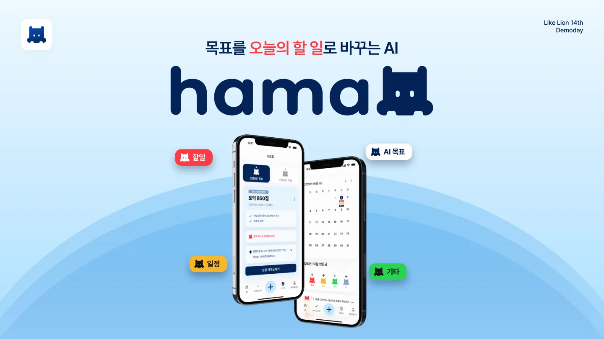
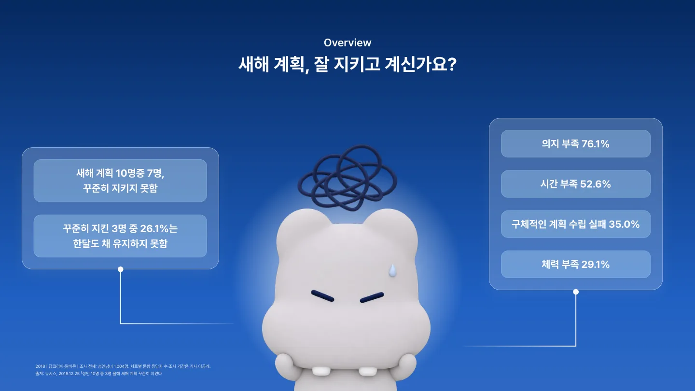
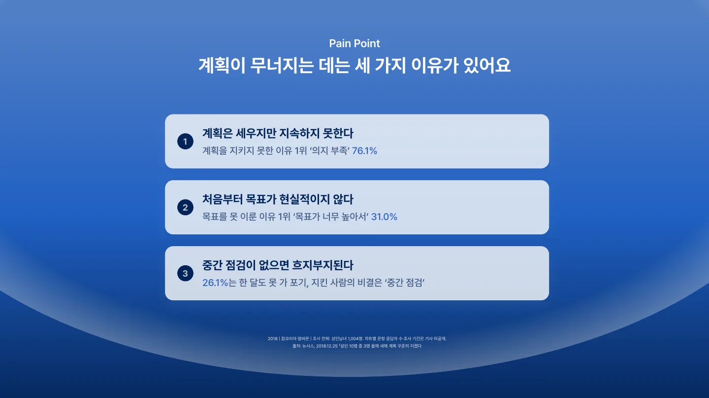
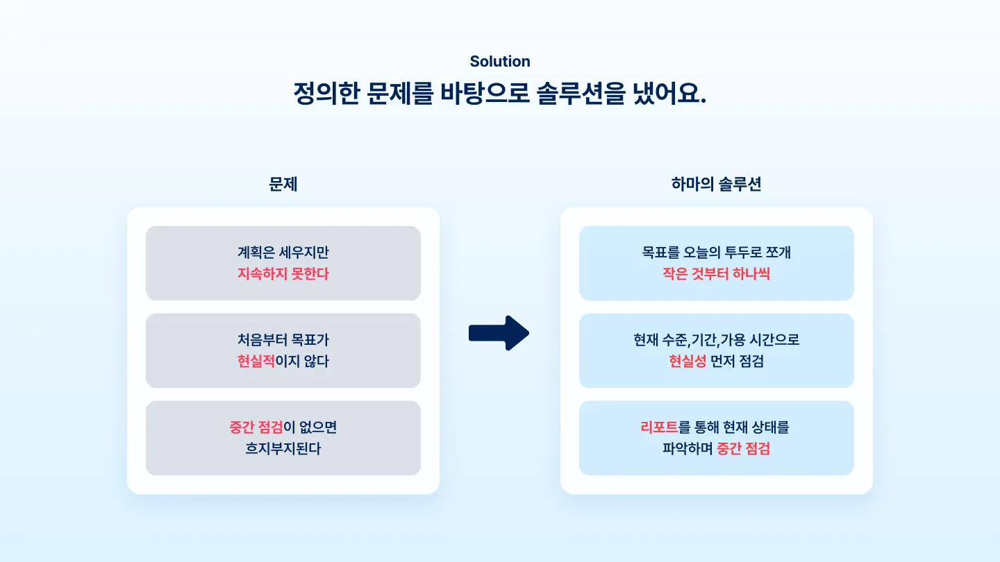
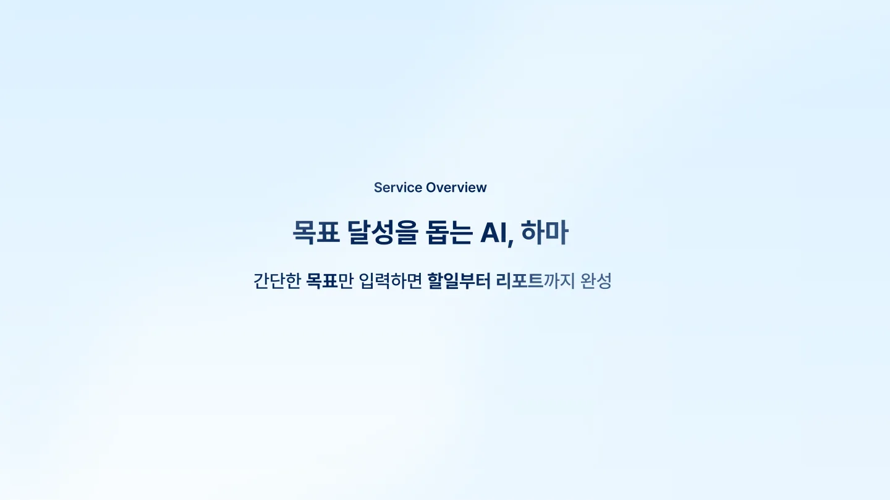
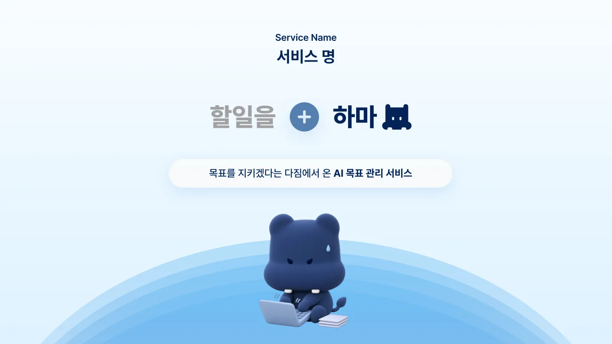
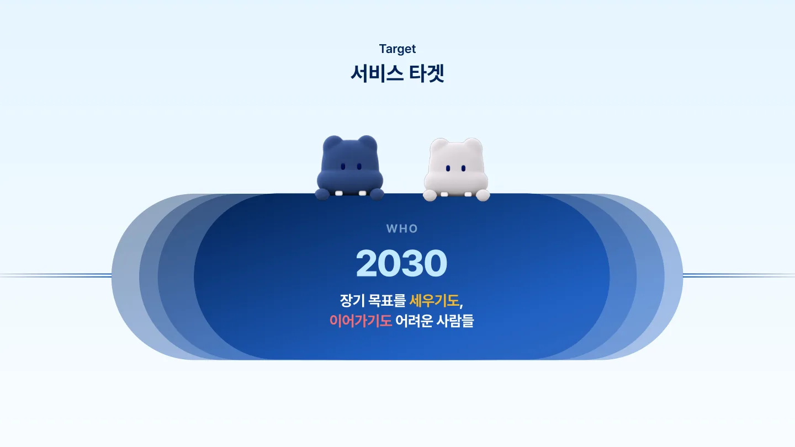
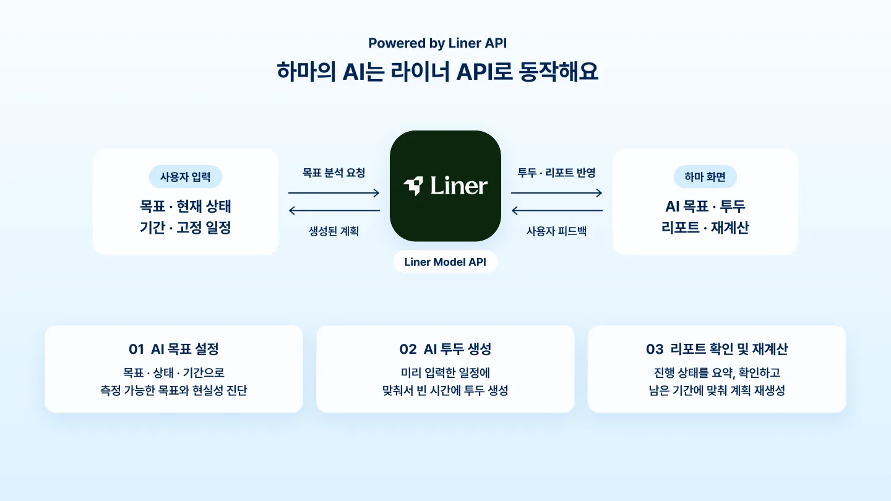
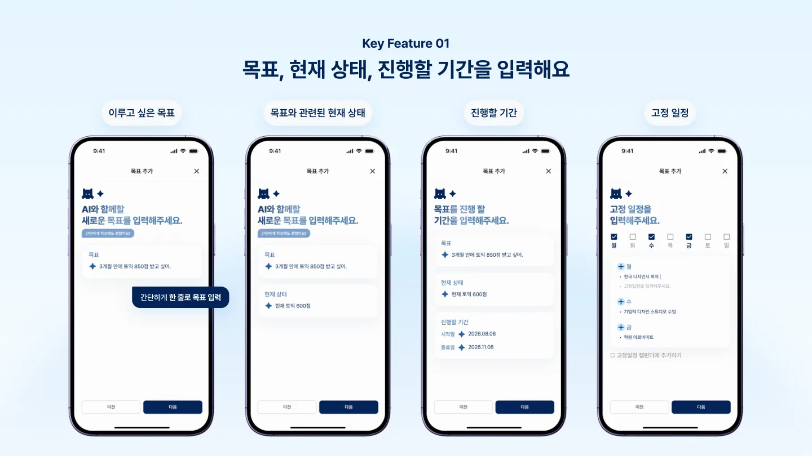
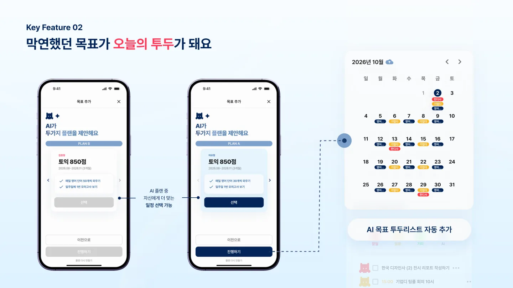
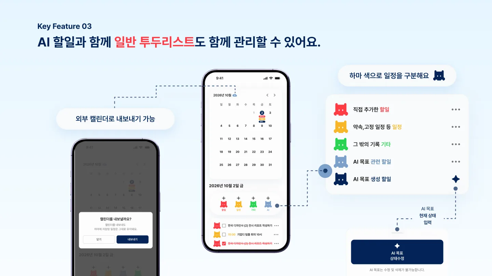
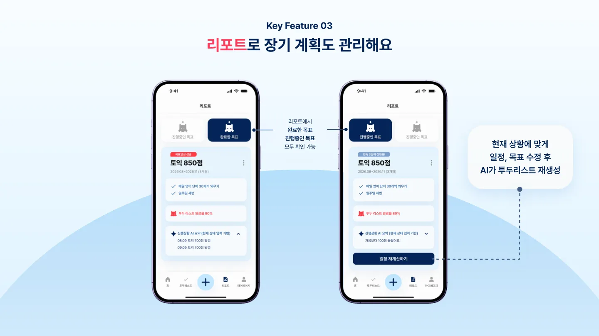
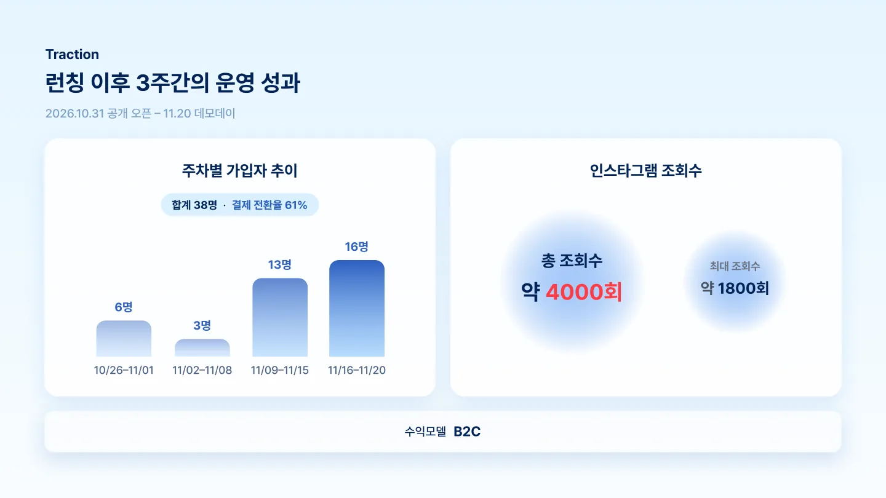
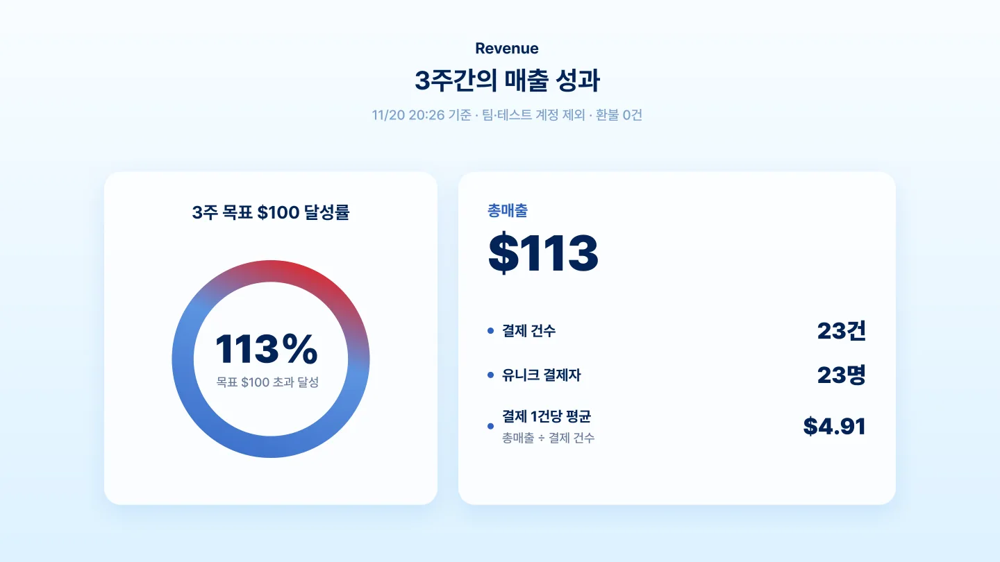
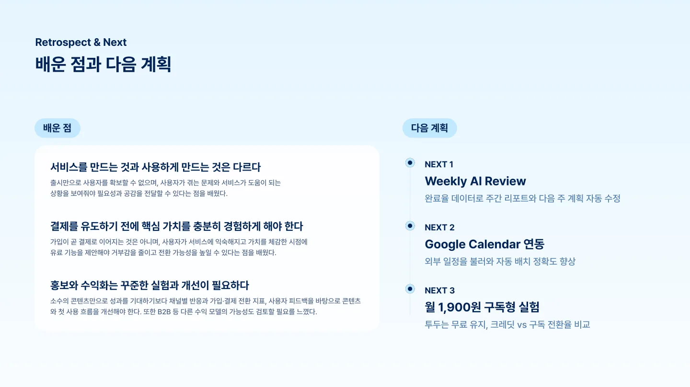
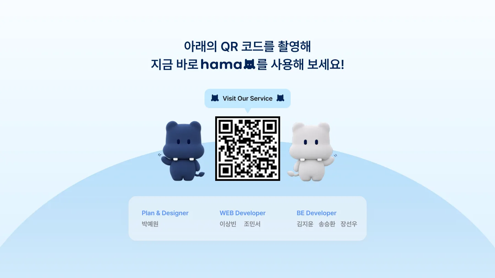

### [하마 바로가기](https://www.todohama.site) 

 

## 기술 스택

### Frontend

### Backend

### Infra · DevOps

### External

 

## 서비스 구조도

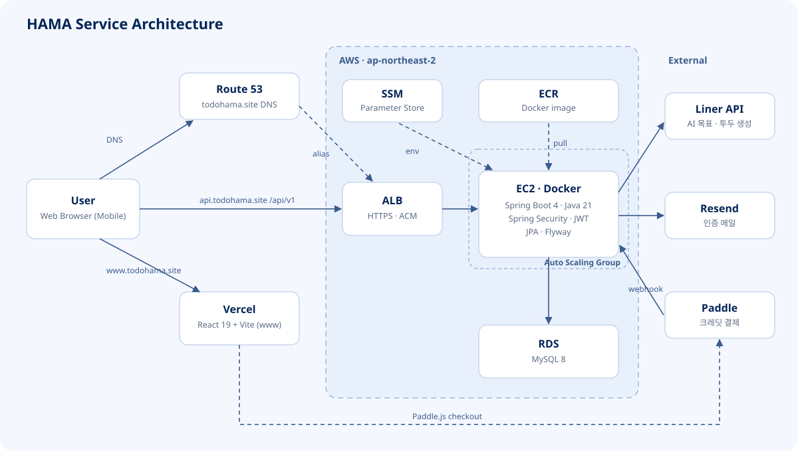

 

## CI/CD

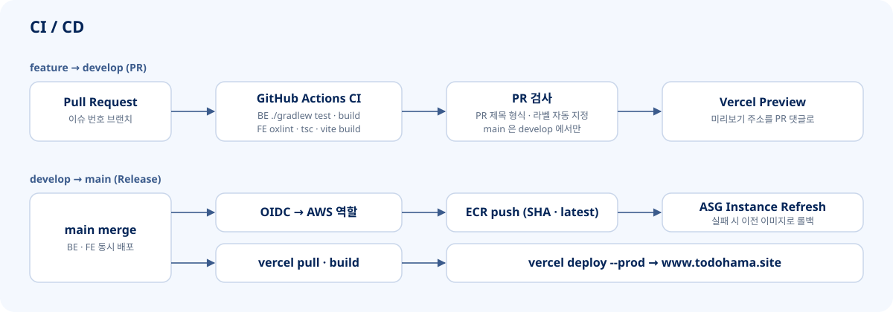

 

## 문서

- [협업 규칙](CONTRIBUTING.md): 이슈·브랜치·커밋·PR 형식, 머지 조건
- [백엔드 개발 가이드](backend/README.md): 실행 방법, 설정, 도메인 · 담당, DB 마이그레이션, 코드 규칙
- [프론트엔드 개발 가이드](frontend/README.md): 실행 방법, 기술 스택, 폴더 구조, 인증 흐름

## 라이선스

코드는 [MIT License](LICENSE) 를 따릅니다. 로고 · 하마 캐릭터 · 장표 이미지 등 디자인 에셋은 라이선스에 포함되지 않습니다.
