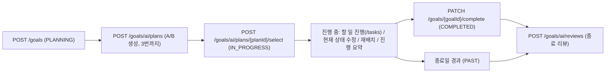

# 목표(goals) API 연동 명세

프론트 연동용 문서입니다. 모든 내용은 현재 백엔드 코드 기준입니다. 예전 API 를 쓰던 화면은 먼저 [이전 API 에서 바뀐 점](#이전-api-에서-바뀐-점) 을 봐주세요.

## 0. 공통 규칙

### 인증
모든 API 는 로그인이 필요합니다.

```
Authorization: Bearer {accessToken}
Content-Type: application/json
```

토큰이 없거나 만료되면 `401 UNAUTHORIZED` 입니다.

### 공통 응답 형식
성공·실패 모두 아래 형식으로 감싸서 내려옵니다. 아래 각 API 의 "응답" 은 `data` 안의 내용만 적었습니다.

```json
// 성공
{ "success": true, "data": { ... }, "error": null, "traceId": "a1b2c3d4e5f6a7b8" }

// 실패 (data 는 항상 null)
{ "success": false, "data": null,
  "error": { "code": "GOAL_NOT_FOUND", "message": "목표를 찾을 수 없습니다.", "fields": null },
  "traceId": "a1b2c3d4e5f6a7b8" }

// 필드 검증 실패 (400 VALIDATION_FAILED) 일 때만 fields 가 채워짐
{ "success": false, "data": null,
  "error": { "code": "VALIDATION_FAILED", "message": "입력 데이터 검증에 실패했습니다.",
             "fields": { "title": "목표 제목은 필수입니다." } },
  "traceId": "..." }
```

- 분기는 `error.message` 가 아니라 **`error.code`** 로 해주세요. 문구는 바뀔 수 있습니다.
- 문제가 생기면 `traceId` 를 백엔드에 알려주세요.

### 페이징 응답 (`PageResponse<T>`)
```json
{ "content": [ ... ], "page": 0, "size": 20, "totalElements": 1 }
```
- 쿼리 `page` 는 0부터, `size` 는 1~100(기본 20). 벗어나면 `400 VALIDATION_FAILED`.

### 값 형식
| 타입 | 형식 | 예 |
| --- | --- | --- |
| 날짜 | `yyyy-MM-dd` | `"2026-10-05"` |
| 일시 | `yyyy-MM-dd'T'HH:mm:ss` (KST) | `"2026-10-04T10:30:00"` |
| 요일 `DayOfWeek` | 영문 대문자 | `MONDAY` ~ `SUNDAY` |
| 진행률 `progressRate` | 소수 첫째 자리 숫자 | `50.0` |

### 크레딧
| 동작 | 크레딧 |
| --- | --- |
| 목표 생성 (2번) | 차감 없음. 단 **잔액이 0 이면 402** (뒤에 플랜 선택에서 쓸 1개가 있는지 미리 확인) |
| A/B 플랜 생성 (9번) | 차감 없음. 대신 **목표당 3번까지** |
| 플랜 선택 (11번) | 1개 |
| AI 투두 재배치 (12번) | 1개 (옮긴 투두가 0개면 차감 없음) |
| 종료 AI 리뷰 생성 (13번) | 1개 (같은 입력 재사용은 차감 없음) |

`402 INSUFFICIENT_CREDITS` 를 받으면 크레딧 부족 모달을 띄워주세요.

### 목표 상태 `status`
| 값 | 의미 | 진입 조건 |
| --- | --- | --- |
| `PLANNING` | 플랜 선택 전 | 목표를 만들면 항상 이 상태 |
| `IN_PROGRESS` | 진행 중 | A/B 플랜을 선택하면 |
| `COMPLETED` | 사용자가 직접 완료 | `PATCH /goals/{goalId}/complete` |
| `PAST` | 지난 목표 | 진행 중인데 종료일이 오늘(KST)보다 이전이면 자동 계산 |

`COMPLETED` 는 종료일이 지나도 `PAST` 로 바뀌지 않습니다.

### 목표 결과 `resultStatus`
종료 AI 리뷰를 받기 전에는 `null` 입니다. 리뷰 뒤에는 `ACHIEVED`(달성) 또는 `MISSED`(미달성) 입니다.

### AI 라벨 `aiPlanApplied`
A/B 플랜을 선택해 AI 투두가 만들어진 목표면 `true` 입니다. 현재 상태 수정과 목표 완료는 `true` 인 목표만 할 수 있습니다.

### 시작 상태 `initialStatus` 와 현재 상태 `currentStatus`
- `initialStatus`: 목표를 만들 때 보낸 `currentStatus`. **이후 바뀌지 않습니다.** 종료 리뷰의 "처음보다 얼마나 나아졌는지" 비교 기준입니다.
- `currentStatus`: 지금 상태. 5번 API 로 바꿉니다.
- 공백만 보내면 `null` 로 저장합니다.

### 전체 흐름



### 엔드포인트 한눈에 보기
| # | 메서드 | 경로 | 설명 |
| --- | --- | --- | --- |
| 1 | GET | `/api/v1/goals` | 목표 리스트 |
| 2 | POST | `/api/v1/goals` | 목표 생성 |
| 3 | GET | `/api/v1/goals/{goalId}` | 목표 상세 |
| 4 | PATCH | `/api/v1/goals/{goalId}` | 목표 수정 (제목·기간) |
| 5 | PATCH | `/api/v1/goals/{goalId}/current-status` | 현재 상태 수정 (AI 목표만) |
| 6 | PATCH | `/api/v1/goals/{goalId}/complete` | 목표 완료 (AI 목표만) |
| 7 | DELETE | `/api/v1/goals/{goalId}` | 목표 삭제 |
| 8 | GET | `/api/v1/goals/fixed-schedules` | 고정 일정 날짜별 조회 |
| 9 | POST | `/api/v1/goals/ai/plans` | A/B 플랜 생성 |
| 10 | GET | `/api/v1/goals/ai/plans` | 플랜 조회 |
| 11 | POST | `/api/v1/goals/ai/plans/{planId}/select` | 플랜 선택 |
| 12 | POST | `/api/v1/goals/ai/replan` | AI 투두 재배치 |
| 13 | POST | `/api/v1/goals/ai/reviews` | 종료 AI 리뷰 생성 |
| 14 | GET | `/api/v1/goals/ai/reviews` | 종료 AI 리뷰 조회 |
| 15 | GET | `/api/v1/goals/{goalId}/progress-records` | 현재 상태 기록 조회 |
| 16 | GET | `/api/v1/goals/{goalId}/progress-summary` | 진행 중 AI 요약 조회 |
| 17 | POST | `/api/v1/goals/{goalId}/progress-summary/retry` | 진행 요약 재시도 |
| 18 | GET | `/api/v1/goals/{goalId}/tasks` | 할 일별 진행 (**새로 추가**, 예전 `/tree` 대체) |

모든 `{goalId}` API 공통: 없거나 삭제된 목표는 `404 GOAL_NOT_FOUND`, 다른 사람의 목표는 `403 FORBIDDEN` 입니다.

AI 를 부르는 API(9, 13) 공통: `429 AI_RATE_LIMIT`, `502 AI_UPSTREAM_ERROR`, `503 AI_NOT_CONFIGURED` 가 올 수 있습니다.

---

## 1. 목표 리스트 조회

`GET /api/v1/goals?status={status}&page=0&size=20`

| 쿼리 | 필수 | 설명 |
| --- | --- | --- |
| `status` | X | `IN_PROGRESS`(마감 가까운 순) / `PAST`(최근 종료 순) / `COMPLETED`(최근 변경 순). 생략하면 PLANNING 포함 전체(최근 생성 순) |
| `page` | X | 기본 0 |
| `size` | X | 기본 20, 최대 100 |

**응답** `PageResponse<GoalSummary>`
```json
{
  "content": [
    {
      "goalId": 3,
      "title": "매일 영어 공부",
      "status": "IN_PROGRESS",
      "startDate": "2026-10-01",
      "endDate": "2026-12-31",
      "progressRate": 50.0,
      "resultStatus": null,
      "aiPlanApplied": true
    }
  ],
  "page": 0, "size": 20, "totalElements": 1
}
```

**에러**
- `400 BINDING_ERROR`: `status` 값이 잘못됨 (`PLANNING` 은 필터로 쓸 수 없음)
- `400 VALIDATION_FAILED`: page·size 범위 초과

---

## 2. 목표 생성

`POST /api/v1/goals`

AI 없이 목표만 만듭니다. 항상 `PLANNING` 으로 시작하고 투두는 아직 없습니다. 크레딧은 쓰지 않지만 **잔액이 0 이면 만들지 않고 402** 를 돌려줍니다.

**요청**
```json
{
  "title": "매일 영어 공부",
  "currentStatus": "토익 600점",
  "startDate": "2026-10-01",
  "endDate": "2026-12-31",
  "fixedSchedules": [
    { "dayOfWeek": "MONDAY", "content": "한국사 공부" },
    { "dayOfWeek": "WEDNESDAY", "content": "야근" }
  ]
}
```

| 필드 | 타입 | 필수 | 제약 |
| --- | --- | --- | --- |
| `title` | string | O | 공백 불가, 100자 이하 |
| `currentStatus` | string | X | 200자 이하. 자유 텍스트. `initialStatus` 로도 저장됨 |
| `startDate` | date | O | 종료일보다 늦을 수 없음 |
| `endDate` | date | O | 오늘(KST) 이후. 시작일 포함 최대 365일 |
| `fixedSchedules` | array | X | 최대 7개, **요일마다 하나만**, `null` 항목 불가 |
| `fixedSchedules[].dayOfWeek` | DayOfWeek | O | |
| `fixedSchedules[].content` | string | O | 공백 불가, 100자 이하 |

고정 일정은 "이 요일엔 이미 바쁘다" 는 정보입니다. A/B 플랜을 만들 때 **그 요일에는 투두를 두지 않습니다**(모든 요일이 바쁘면 예외로 모든 요일 사용). 8번 API 로 날짜별로 볼 수 있습니다.

**응답** `201 Created`
```json
{ "goalId": 3, "status": "PLANNING" }
```

**에러**
- `400 VALIDATION_FAILED`: 필드 검증 실패 (`error.fields` 확인). `fixedSchedules: [null]` 도 여기
- `400 GOAL_INVALID_PERIOD`: 시작일 > 종료일, 또는 종료일이 오늘 이전
- `400 GOAL_PERIOD_TOO_LONG`: 기간 365일 초과
- `400 GOAL_INVALID_INPUT`: 같은 요일의 고정 일정이 두 개 이상
- `402 INSUFFICIENT_CREDITS`: 크레딧 잔액 0 (목표를 만들지 않음)

---

## 3. 목표 상세 조회

`GET /api/v1/goals/{goalId}`

**응답** `GoalDetail`
```json
{
  "goalId": 3,
  "title": "매일 영어 공부",
  "initialStatus": "토익 600점",
  "currentStatus": "토익 700점",
  "startDate": "2026-10-01",
  "endDate": "2026-12-31",
  "status": "IN_PROGRESS",
  "progressRate": 50.0,
  "resultStatus": null,
  "aiPlanApplied": true,
  "fixedSchedules": [
    { "dayOfWeek": "MONDAY", "content": "한국사 공부" },
    { "dayOfWeek": "WEDNESDAY", "content": "야근" }
  ],
  "createdAt": "2026-10-01T09:00:00"
}
```
- `initialStatus`: 생성 때의 상태. 바뀌지 않습니다.
- `progressRate` = 완료한 AI 투두 ÷ 전체 AI 투두 × 100. AI 투두가 없으면 `0.0`.
- `fixedSchedules` 는 요일 순(월→일)입니다. 없으면 빈 배열.

---

## 4. 목표 수정 (제목·기간)

`PATCH /api/v1/goals/{goalId}`

부분 수정입니다. **보내지 않은 필드는 그대로**, `null` 을 보내면 지웁니다(`title` 은 null 이어도 유지). `currentStatus` 는 여기서 못 바꾸고 5번 API 를 써야 합니다.

**요청** (원하는 필드만)
```json
{ "title": "3개월 안에 토익 850점", "endDate": "2027-01-15" }
```

| 필드 | 타입 | 제약 |
| --- | --- | --- |
| `title` | string | 공백만은 불가, 100자 이하 |
| `startDate` | date \| null | 진행 중 목표에 null 을 보내면 400 |
| `endDate` | date \| null | 오늘 이후. 진행 중 목표에 null 을 보내면 400 |

**응답** `GoalDetail` (3번과 같음)

**에러**
- `409 GOAL_NOT_EDITABLE`: 지난 목표(PAST) 또는 완료한 목표(COMPLETED)
- `400 GOAL_INVALID_PERIOD`, `400 GOAL_PERIOD_TOO_LONG`, `400 GOAL_INVALID_INPUT`

---

## 5. 현재 상태 수정 (AI 목표만)

`PATCH /api/v1/goals/{goalId}/current-status`

`aiPlanApplied = true` 인 목표의 `currentStatus` 만 바꿉니다. `initialStatus` 는 그대로입니다.

**요청**
```json
{ "currentStatus": "토익 700점" }
```
| 필드 | 타입 | 제약 |
| --- | --- | --- |
| `currentStatus` | string \| null | 200자 이하. null 이나 공백이면 지움 |

**응답**
```json
{ "goalId": 3, "currentStatus": "토익 700점", "updatedAt": "2026-10-04T10:30:00" }
```
- `updatedAt` 은 이번 수정이 반영된 시각입니다(다른 일시와 같은 초 단위 형식).

**에러**
- `409 GOAL_AI_PLAN_NOT_APPLIED`: 플랜을 선택하지 않은 목표
- `409 GOAL_NOT_EDITABLE`: 지난 목표(PAST) 또는 완료한 목표(COMPLETED)
- `400 VALIDATION_FAILED`: 200자 초과

---

## 6. 목표 완료 (AI 목표만)

`PATCH /api/v1/goals/{goalId}/complete`

진행 중(`IN_PROGRESS`)인 AI 목표를 `COMPLETED` 로 바꿉니다. **요청 본문 없음.**

완료 후에는:
- 수정(4, 5번), AI 투두 추가·미루기·재배치를 할 수 없습니다.
- 삭제는 할 수 있습니다.
- 남은 AI 투두는 지워지지 않습니다.
- 종료일 전이어도 종료 AI 리뷰(13번)를 만들 수 있습니다 (END 체크인은 필요).

**응답** `GoalDetail` (3번과 같음, `status: "COMPLETED"`)

**에러**
- `409 GOAL_AI_PLAN_NOT_APPLIED`: 플랜을 선택하지 않은 목표
- `409 GOAL_NOT_IN_PROGRESS`: PLANNING, 이미 COMPLETED, 또는 PAST

---

## 7. 목표 삭제

`DELETE /api/v1/goals/{goalId}`

`PLANNING`, `PAST`, `COMPLETED` 목표만 지울 수 있습니다. 연결된 투두도 함께 지워집니다.

**응답** `200`, `data: null`

**에러**
- `409 GOAL_NOT_DELETABLE`: 진행 중(IN_PROGRESS) 목표

---

## 8. 고정 일정 날짜별 조회

`GET /api/v1/goals/fixed-schedules?from=2026-10-04&to=2026-10-10`

내 모든 목표의 요일별 고정 일정을 실제 날짜로 펼쳐 **날짜별로 묶어서** 돌려줍니다.

| 쿼리 | 필수 | 설명 |
| --- | --- | --- |
| `from` | O | `yyyy-MM-dd` |
| `to` | O | `yyyy-MM-dd`. from 부터 366일 미만 |

- 각 목표의 기간(startDate~endDate) 밖의 날짜는 빠집니다.
- 일정이 하나도 없는 날짜는 응답에 없습니다.
- 날짜 오름차순, 같은 날짜 안에서는 목표를 만든 순서입니다.

**응답**
```json
{
  "days": [
    {
      "date": "2026-10-05",
      "schedules": [
        { "goalId": 3, "goalTitle": "토익", "dayOfWeek": "MONDAY", "content": "한국사 공부" },
        { "goalId": 4, "goalTitle": "운동", "dayOfWeek": "MONDAY", "content": "병원" }
      ]
    },
    {
      "date": "2026-10-07",
      "schedules": [
        { "goalId": 3, "goalTitle": "토익", "dayOfWeek": "WEDNESDAY", "content": "야근" },
        { "goalId": 4, "goalTitle": "운동", "dayOfWeek": "WEDNESDAY", "content": "헬스" }
      ]
    }
  ]
}
```

**에러**
- `400 GOAL_INVALID_RANGE`: from/to 누락, from > to, 366일 이상
- `400 BINDING_ERROR`: 날짜 형식이 `yyyy-MM-dd` 가 아님

---

## 9. A/B 플랜 생성

`POST /api/v1/goals/ai/plans`

`PLANNING` 목표에 A(여유형)·B(집중형) 플랜을 만듭니다. 다시 부르면 선택하지 않은 기존 플랜을 새 플랜으로 바꿉니다. 크레딧은 쓰지 않지만 **목표당 3번까지** 성공할 수 있습니다(실패한 생성은 세지 않음). `remainingGenerations` 가 0 이면 "다시 만들기" 버튼을 막아주세요.

**요청**
```json
{ "goalId": 3, "preference": "BALANCED" }
```
| 필드 | 타입 | 필수 | 설명 |
| --- | --- | --- | --- |
| `goalId` | number | O | 양수 |
| `preference` | string | X | `RELAXED`(여유 있게) / `BALANCED`(균형, 기본) / `INTENSIVE`(짧고 굵게) |

**응답** `201 Created` `PlanList`
```json
{
  "remainingGenerations": 2,
  "plans": [
    {
      "planId": 10,
      "variant": "A",
      "title": "여유형",
      "summary": "매일 영어 단어 30개씩 외우기 / 일주일에 모의고사 1번 보기",
      "tasks": [
        { "content": "영어 단어 30개 외우기", "timesPerWeek": 7, "minutes": 20 },
        { "content": "모의고사 1회", "timesPerWeek": 1, "minutes": 120 }
      ],
      "stats": { "totalTodos": 104, "avgDailyMinutes": 35 },
      "selected": false
    },
    { "planId": 11, "variant": "B", "title": "집중형", "...": "..." }
  ]
}
```
- `remainingGenerations`: 이 목표에서 플랜을 더 만들 수 있는 횟수(0~3)
- `tasks[].timesPerWeek`: 1주일에 하는 횟수(1~7), `minutes`: 1회 소요 분
- `stats.totalTodos`: 선택하면 만들어질 투두 수(고정 일정 요일은 빼고 셈), `avgDailyMinutes`: 투두가 있는 날 하루 평균 분

**에러**
- `429 AI_PLAN_GENERATION_LIMIT`: 이 목표에서 이미 3번 만듦 (AI 를 부르지 않음)
- `409 GOAL_NOT_PLANNING`: PLANNING 이 아닌 목표
- `400 GOAL_INVALID_PERIOD`: 기간이 없거나 이미 끝난 목표
- `409 AI_PLAN_OUTDATED`: 만드는 도중 목표 기간이 바뀜
- AI 공통 에러 (429 AI_RATE_LIMIT / 502 / 503). 같은 429 라도 `error.code` 로 구분해주세요.

---

## 10. 플랜 조회

`GET /api/v1/goals/ai/plans?goalId=3`

**응답** `PlanList` (9번과 같음). 플랜이 없으면 `{ "remainingGenerations": 3, "plans": [] }`.

---

## 11. 플랜 선택

`POST /api/v1/goals/ai/plans/{planId}/select`

**요청 본문 없음.** 플랜대로 투두를 만들고 목표를 `IN_PROGRESS` 로 바꿉니다. **크레딧 1개**를 씁니다(실패하면 차감 안 됨).

투두는 그날 09:00~22:00 중 고정·개인 일정과 시간이 정해진 기존 투두를 피한 첫 빈 시간(10분 단위)에 둡니다. 빈 시간이 없으면 시간 없이 날짜만 둡니다. 투두 내용(`content`)은 플랜 할 일의 `content` 와 같아서 18번 API 로 할 일별 진행을 볼 수 있습니다.

**응답** `SelectResponse`
```json
{
  "goalId": 3,
  "status": "IN_PROGRESS",
  "created": { "todos": 104 },
  "placement": {
    "placed": 100,
    "unplaced": 4,
    "unplacedTodos": [
      { "content": "모의고사 1회", "todoDate": "2026-10-10" }
    ]
  }
}
```

**에러**
- `402 INSUFFICIENT_CREDITS`: 크레딧 부족 (다른 검사보다 먼저)
- `404 AI_PLAN_NOT_FOUND`, `403 FORBIDDEN`
- `409 AI_PLAN_ALREADY_SELECTED`: 이미 고른 플랜
- `409 GOAL_NOT_PLANNING`: 같은 목표의 다른 플랜을 이미 고름
- `409 AI_PLAN_OUTDATED`: 목표 기간이 바뀌었거나 플랜 시작일이 지남 (플랜을 다시 만들어야 함)

---

## 12. AI 투두 재배치

`POST /api/v1/goals/ai/replan`

진행 중인 목표의 미완료 AI 투두 중 밀린 것·시간 없는 것·일정과 겹친 것을 빈 시간으로 옮깁니다. **크레딧 1개** (실패하거나 옮긴 투두가 0개면 차감 안 됨).

**요청**
```json
{ "goalId": 3, "fromDate": "2026-10-08" }
```
| 필드 | 타입 | 필수 | 설명 |
| --- | --- | --- | --- |
| `goalId` | number | O | |
| `fromDate` | date | X | 생략하면 오늘과 목표 시작일 중 늦은 날. 오늘 이후·목표 기간 안 |

**응답**
```json
{ "movedCount": 5, "unplacedCount": 1 }
```
- `movedCount`: 날짜나 시간이 바뀐 투두 수
- `unplacedCount`: 빈 시간이 없어 날짜만 둔 투두 수

**에러**
- `402 INSUFFICIENT_CREDITS`
- `409 GOAL_NOT_IN_PROGRESS`: 진행 중이 아닌 목표 (COMPLETED·PAST 포함)
- `400 AI_REPLAN_INVALID_DATE`: fromDate 가 오늘 이전이거나 목표 기간 밖

---

## 13. 종료 AI 리뷰 생성

`POST /api/v1/goals/ai/reviews`

END 체크인 뒤 목표 전체를 AI 에 넘겨 달성 여부와 멘트 두 줄을 받습니다. AI 는 **`initialStatus`(시작 상태)와 지금 상태를 비교**합니다.

**요청**
```json
{ "goalId": 3, "currentStatus": "토익 860점" }
```
| 필드 | 타입 | 필수 | 설명 |
| --- | --- | --- | --- |
| `goalId` | number | O | |
| `currentStatus` | string | X | 지금 상태 한 줄, 200자 이하. 생략하면 목표의 `currentStatus` 를 씀 |

**응답** `ReviewResponse`
- `201 Created`: 새로 생성 (크레딧 1개 차감)
- `200 OK`: 같은 입력으로 이미 만든 리뷰 재사용 (차감 없음, 잔액 0이어도 가능)

```json
{
  "goalId": 3,
  "achieved": true,
  "comparison": "처음보다 260점 올랐어요!",
  "message": "일정을 모두 소화했어요!",
  "currentStatus": "토익 860점",
  "resultStatus": "ACHIEVED",
  "createdAt": "2026-12-31T21:00:00"
}
```
- `comparison`(성과 비교)과 `message`(칭찬/격려)는 **각각 줄바꿈 없는 40자 이하 한 줄**입니다. 화면에 두 줄로 그대로 보여주면 됩니다.
- `currentStatus` 는 이 리뷰에서 비교에 쓴 지금 상태입니다.
- `achieved` 는 AI 가 판정합니다. 목표의 `resultStatus` 도 같이 바뀝니다.

**에러** (아래 순서대로 검사)
- `402 INSUFFICIENT_CREDITS`: 새로 생성해야 하는데 크레딧 부족
- `409 AI_REVIEW_GOAL_NOT_STARTED`: PLANNING 목표
- `409 AI_REVIEW_GOAL_NOT_ENDED`: 완료(COMPLETED)하지 않았고 종료일도 지나지 않음
- `409 AI_REVIEW_END_REQUIRED`: END 체크인이 없음
- `409 AI_REVIEW_GENERATING`: 이미 생성 중 (잠시 후 14번으로 조회)
- `409 AI_REVIEW_OUTDATED`: AI 응답을 기다리는 동안 목표·체크인이 바뀜 (다시 시도)
- AI 공통 에러 (429 / 502 / 503)

---

## 14. 종료 AI 리뷰 조회

`GET /api/v1/goals/ai/reviews?goalId=3`

**응답** `ReviewResponse` (13번과 같음)

**에러**
- `404 AI_REVIEW_NOT_FOUND`: 아직 리뷰가 없음

---

## 15. 현재 상태 기록 조회

`GET /api/v1/goals/{goalId}/progress-records?page=0&size=20`

완료한 AI 투두에 남긴 상태 메모(`statusNote`) 목록입니다. 입력·수정은 `PATCH /api/v1/todos/state/{todoId}` 로 합니다. 완료 시각 최신순.

**응답** `PageResponse<ProgressRecord>`
```json
{
  "content": [
    {
      "todoId": 120,
      "goalId": 3,
      "content": "영어 단어 30개 외우기",
      "statusNote": "오늘은 40개 외웠다",
      "todoDate": "2026-10-04",
      "completedAt": "2026-10-04T21:10:00"
    }
  ],
  "page": 0, "size": 20, "totalElements": 1
}
```

---

## 16. 진행 중 AI 요약 조회

`GET /api/v1/goals/{goalId}/progress-summary`

상태 기록을 바탕으로 백엔드가 **비동기로 자동 생성**하는 무료 요약입니다. 이 API 는 AI 를 직접 부르지 않으니, `PENDING`/`GENERATING` 이면 잠시 뒤 다시 조회(polling)해주세요.

**응답** `ProgressSummary`
```json
{
  "goalId": 3,
  "status": "READY",
  "summary": "단어 암기를 꾸준히 하고 있어요. 모의고사 비중을 늘려보세요.",
  "generatedAt": "2026-10-04T21:15:00",
  "stale": false,
  "usedRecordCount": 12,
  "sourceRecordCount": 12,
  "currentRecordCount": 12,
  "attempts": 1,
  "nextAttemptAt": null
}
```

| `status` | 의미 | 화면 처리 예 |
| --- | --- | --- |
| `PENDING` | 갱신 대기 | 로딩 표시 후 polling |
| `GENERATING` | 생성 중 | 로딩 표시 후 polling |
| `READY` | 요약 있음 | `summary` 표시 |
| `EMPTY` | 기록이 없어 요약 없음 | 빈 상태 안내 |
| `FAILED` | 생성 실패 | 재시도 버튼(17번) |
| `INACTIVE` | 진행 중이 아닌 목표 | 기존 요약만 표시 |

- `stale: true` 면 요약 이후 입력이 바뀌었다는 뜻입니다(새 요약이 곧 생기거나, 끝난 목표라 더 갱신하지 않음).
- `nextAttemptAt`: 실패 후 다음 자동 재시도 예정 시각 (없으면 null)

---

## 17. 진행 요약 재시도

`POST /api/v1/goals/{goalId}/progress-summary/retry`

**요청 본문 없음.** `FAILED` 일 때 무료로 다시 생성을 예약합니다.

**응답** `ProgressSummary` (16번과 같음)
- `200 OK`: 같은 입력의 기존 요약(READY/EMPTY) 재사용
- `202 Accepted`: 생성 대기·생성 중 (`PENDING`/`GENERATING`) → 16번으로 polling

**에러**
- `409 GOAL_NOT_IN_PROGRESS`: 진행 중이 아닌 목표

---

## 18. 할 일별 진행 조회 (새로 추가)

`GET /api/v1/goals/{goalId}/tasks`

선택한 플랜의 반복 할 일(`tasks`)마다 AI 투두가 몇 개 있고 몇 개 끝났는지 돌려줍니다. 홈 목표 카드와 리포트 체크 목록에서 예전 `/tree` 대신 씁니다. 상태(PLANNING·PAST·COMPLETED)와 관계없이 조회할 수 있습니다.

- `todoTotal` / `todoCompleted`: 목표 전체 기간
- `weekTodoTotal` / `weekTodoCompleted`: 이번 주(KST 월~일, `weekStart`~`weekEnd`)
- 지운 투두는 세지 않습니다.
- 플랜을 선택하지 않은 목표는 `tasks` 가 빈 배열입니다.

**응답** `TaskList`
```json
{
  "goalId": 3,
  "weekStart": "2026-09-28",
  "weekEnd": "2026-10-04",
  "tasks": [
    {
      "content": "영어 단어 50개 외우기",
      "timesPerWeek": 7,
      "minutes": 90,
      "todoTotal": 92,
      "todoCompleted": 2,
      "weekTodoTotal": 4,
      "weekTodoCompleted": 1
    },
    {
      "content": "모의고사 1회",
      "timesPerWeek": 1,
      "minutes": 120,
      "todoTotal": 14,
      "todoCompleted": 0,
      "weekTodoTotal": 1,
      "weekTodoCompleted": 0
    }
  ]
}
```

---

## 이전 API 에서 바뀐 점

### 1) AI 세션 API 삭제 → 생성·플랜·선택 흐름
`/api/v1/goals/ai/sessions/**` 4개는 없어졌습니다(호출하면 404). 아래 순서로 바꿔주세요.

| 예전 | 지금 |
| --- | --- |
| 세션 시작 → 질문/답변 → 목표 확정 | `POST /api/v1/goals` (2번) 로 목표를 바로 만듦. 잔액 0 이면 `402` → 크레딧 부족 모달 |
| 세션에서 플랜 생성 | `POST /api/v1/goals/ai/plans` (9번). 목표당 3번까지, `remainingGenerations` 표시 |
| 세션에서 플랜 확정 | `POST /api/v1/goals/ai/plans/{planId}/select` (11번) |

### 2) `/goals/{goalId}/tree` 삭제 → `/goals/{goalId}/tasks`
마일스톤·기간 목표(월/주) 계층이 없어져 트리 대신 할 일 목록을 씁니다.

| 예전 `GoalTree` | 지금 `TaskList` | 비고 |
| --- | --- | --- |
| `goalId` | `goalId` | 같음 |
| `milestones[]` | `tasks[]` | 계층 없이 평평한 목록 |
| `milestones[].title` | `tasks[].content` | |
| `milestones[].progressRate` | `todoCompleted / todoTotal × 100` | 프론트에서 계산 (todoTotal 0 이면 0) |
| `milestones[].startDate` / `endDate` | 없음 | 목표 상세의 `startDate` / `endDate` 사용 |
| `milestones[].status`, `seq`, `milestoneId` | 없음 | |
| `periodGoals[]` (WEEKLY) `todoTotal` / `todoCompleted` | `tasks[].weekTodoTotal` / `weekTodoCompleted` | 이번 주 기준 |
| `periodGoals[]` (MONTHLY) | 없음 | 필요하면 BE 에 요청 |
| 플랜 미적용이면 `milestones: []` | 플랜 미선택이면 `tasks: []` | |

### 3) 플랜의 `milestones` → `tasks`
`PlanView.milestones` 는 없어지고 `tasks: [{ content, timesPerWeek, minutes }]` 입니다(9번). 플랜 제안 화면은 할 일 목록으로 그려주세요. `PlanList` 에 `remainingGenerations` 가 추가됐습니다.

### 4) 체크인 history 의 `unit` 제거
목표의 지표(단위) 필드가 없어져 체크인 기록에 `unit` 이 오지 않습니다. 화면의 단위 표시를 지워주세요.

### 5) 그 밖에
- `GoalStatus` 에 `COMPLETED` 가 추가됐습니다.
- `GoalDetail` 에 `initialStatus`, `aiPlanApplied`, `fixedSchedules` 가 추가됐습니다.
- `PATCH /current-status` 응답의 `updatedAt` 이 다른 일시와 같은 `yyyy-MM-dd'T'HH:mm:ss` 형식이 됐습니다.

---

## 부록. TypeScript 타입

```ts
export interface ApiResponse<T> {
  success: boolean;
  data: T | null;
  error: { code: string; message: string; fields: Record<string, string> | null } | null;
  traceId: string;
}

export interface PageResponse<T> {
  content: T[];
  page: number;
  size: number;
  totalElements: number;
}

export type GoalStatus = 'PLANNING' | 'IN_PROGRESS' | 'COMPLETED' | 'PAST';
export type GoalListFilter = 'IN_PROGRESS' | 'PAST' | 'COMPLETED';
export type ResultStatus = 'ACHIEVED' | 'MISSED';
export type DayOfWeek = 'MONDAY' | 'TUESDAY' | 'WEDNESDAY' | 'THURSDAY' | 'FRIDAY' | 'SATURDAY' | 'SUNDAY';
export type PlanPreference = 'RELAXED' | 'BALANCED' | 'INTENSIVE';
export type ProgressSummaryStatus = 'PENDING' | 'GENERATING' | 'READY' | 'EMPTY' | 'FAILED' | 'INACTIVE';

// ---- 요청 ----
export interface CreateGoalRequest {
  title: string;
  currentStatus?: string;
  startDate: string; // yyyy-MM-dd
  endDate: string;
  fixedSchedules?: { dayOfWeek: DayOfWeek; content: string }[];
}

export interface UpdateGoalRequest {
  title?: string;
  startDate?: string | null;
  endDate?: string | null;
}

export interface UpdateCurrentStatusRequest { currentStatus: string | null }
export interface GeneratePlanRequest { goalId: number; preference?: PlanPreference }
export interface ReplanRequest { goalId: number; fromDate?: string }
export interface CreateReviewRequest { goalId: number; currentStatus?: string }

// ---- 응답 ----
export interface GoalCreated { goalId: number; status: GoalStatus }

export interface GoalSummary {
  goalId: number;
  title: string;
  status: GoalStatus;
  startDate: string | null;
  endDate: string | null;
  progressRate: number;
  resultStatus: ResultStatus | null;
  aiPlanApplied: boolean;
}

export interface GoalDetail extends GoalSummary {
  initialStatus: string | null;
  currentStatus: string | null;
  fixedSchedules: { dayOfWeek: DayOfWeek; content: string }[];
  createdAt: string; // yyyy-MM-ddTHH:mm:ss
}

export interface CurrentStatusResponse { goalId: number; currentStatus: string | null; updatedAt: string }

export interface FixedScheduleDays {
  days: {
    date: string;
    schedules: { goalId: number; goalTitle: string; dayOfWeek: DayOfWeek; content: string }[];
  }[];
}

export interface PlanList {
  remainingGenerations: number; // 0~3
  plans: {
    planId: number;
    variant: 'A' | 'B';
    title: string;
    summary: string;
    tasks: { content: string; timesPerWeek: number; minutes: number }[];
    stats: { totalTodos: number; avgDailyMinutes: number };
    selected: boolean;
  }[];
}

export interface SelectResponse {
  goalId: number;
  status: GoalStatus;
  created: { todos: number };
  placement: { placed: number; unplaced: number; unplacedTodos: { content: string; todoDate: string }[] };
}

export interface ReplanResponse { movedCount: number; unplacedCount: number }

export interface ReviewResponse {
  goalId: number;
  achieved: boolean;
  comparison: string; // 한 줄, 40자 이하
  message: string;    // 한 줄, 40자 이하
  currentStatus: string | null;
  resultStatus: ResultStatus | null;
  createdAt: string;
}

export interface ProgressRecord {
  todoId: number;
  goalId: number;
  content: string;
  statusNote: string;
  todoDate: string;
  completedAt: string;
}

export interface ProgressSummary {
  goalId: number;
  status: ProgressSummaryStatus;
  summary: string | null;
  generatedAt: string | null;
  stale: boolean;
  usedRecordCount: number;
  sourceRecordCount: number;
  currentRecordCount: number;
  attempts: number;
  nextAttemptAt: string | null;
}

export interface TaskList {
  goalId: number;
  weekStart: string; // 이번 주 월요일
  weekEnd: string;   // 이번 주 일요일
  tasks: {
    content: string;
    timesPerWeek: number;
    minutes: number;
    todoTotal: number;
    todoCompleted: number;
    weekTodoTotal: number;
    weekTodoCompleted: number;
  }[];
}
```
